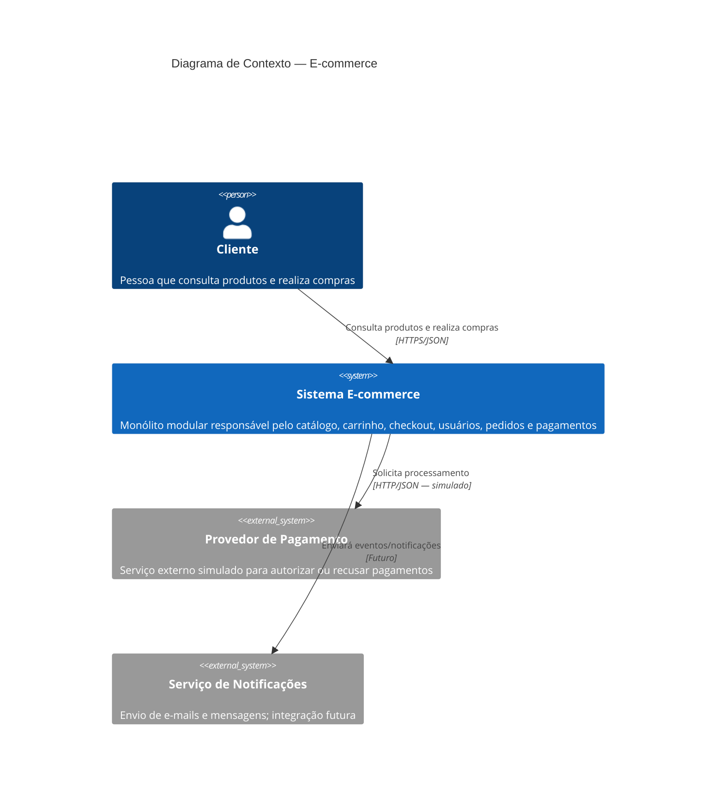

# 03 — C4: Diagrama de Contexto

## Leitura
O Cliente interage com o Sistema E-commerce. O sistema concentra os módulos internos em uma única aplicação. O provedor de pagamento é externo e simulado nesta versão. Notificações ficam fora do escopo inicial e são uma possibilidade futura.
