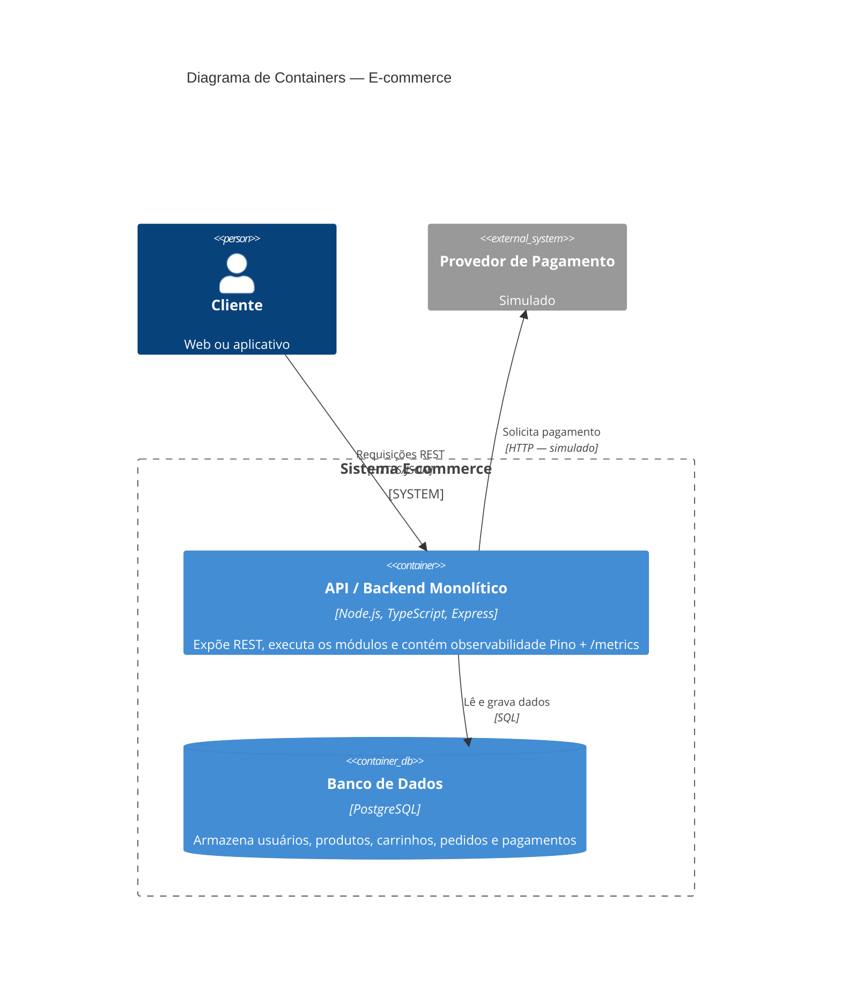

# 04 — C4: Diagrama de Containers

## Execução
- API: processo Node.js/Express.
- PostgreSQL: container Docker.
- Pino e métricas Prometheus: bibliotecas embutidas na API, não são containers separados.
