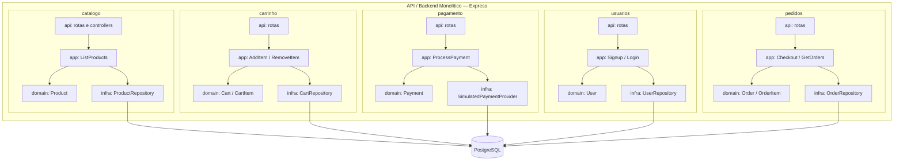

# 05 — C4: Componentes

O container principal é a API monolítica. Internamente, ela é dividida em cinco módulos. Cada módulo segue as camadas `api → app → domain → infra`.

## Responsabilidade das camadas
- `api`: recebe HTTP, valida o formato da entrada e transforma o resultado em resposta.
- `app`: coordena os casos de uso e as regras do fluxo da aplicação.
- `domain`: contém entidades, tipos e regras de negócio independentes de Express e PostgreSQL.
- `infra`: implementa persistência e integrações externas.

## Regra de dependência
A camada `api` chama `app`. A camada `app` depende de contratos/abstrações do domínio ou da aplicação. A infraestrutura implementa esses contratos. O domínio não deve importar Express, PostgreSQL ou bibliotecas de infraestrutura.
