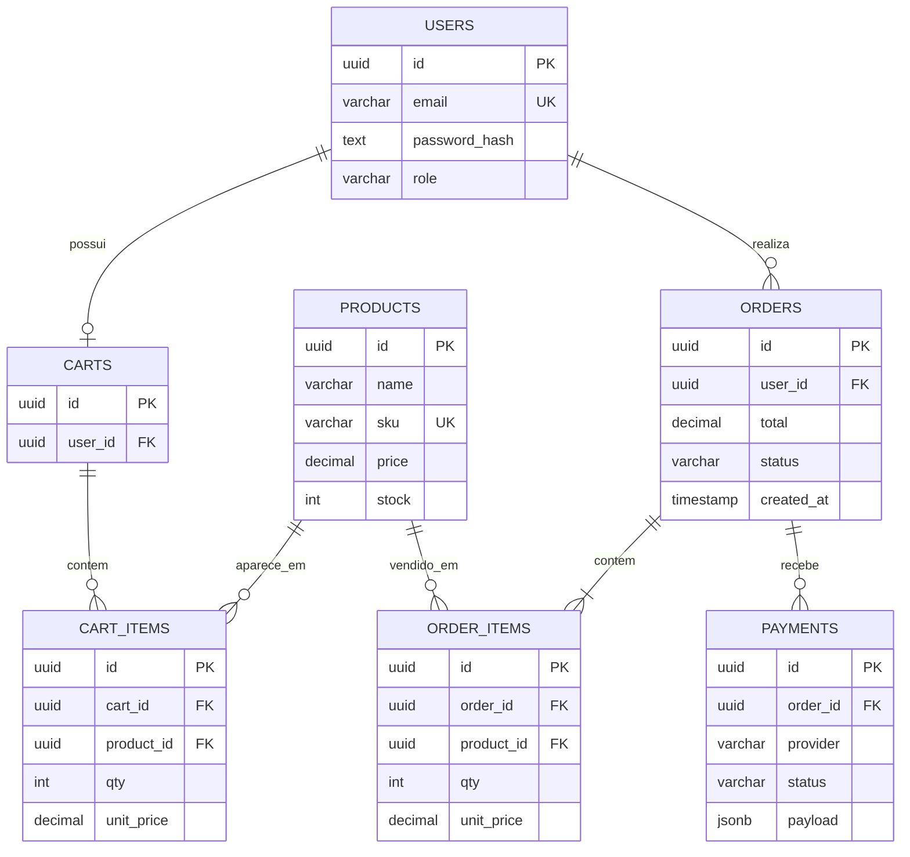

# 06 — Modelo de Dados

## Tabelas iniciais

| Tabela | Campos principais | Relacionamentos |
|---|---|---|
| users | id, email, password_hash, role | 1:N com orders; 1:1 com carts |
| products | id, name, sku, price, stock | referenciada por cart_items e order_items |
| carts | id, user_id | N:1 com users; 1:N com cart_items |
| cart_items | id, cart_id, product_id, qty, unit_price | N:1 com carts e products |
| orders | id, user_id, total, status, created_at | N:1 com users; 1:N com order_items; 1:N com payments |
| order_items | id, order_id, product_id, qty, unit_price | N:1 com orders e products |
| payments | id, order_id, provider, status, payload | N:1 com orders |

## Diagrama ER

## Decisões importantes
- Valores monetários usam `NUMERIC(12,2)`, evitando imprecisão de ponto flutuante.
- `unit_price` é armazenado no item do carrinho/pedido para preservar o preço aplicado naquele momento.
- `password_hash` nunca armazena senha em texto puro.
- `payload` é JSONB para guardar dados técnicos do retorno simulado do pagamento.
- A migration inicial cria chaves estrangeiras, unicidade e restrições básicas.
